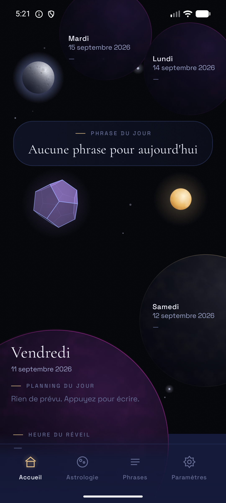

# Astro

Application Android native, écrite en **Kotlin** avec **Jetpack Compose** : un
planning quotidien présenté comme un ciel, avec des éphémérides du Soleil et de la Lune
calculées directement sur l'appareil.

<p align="center">
  
</p>

## Fonctionnalités

- **Accueil en ciel animé** : quatre « planètes-journées » (le jour, le lendemain, J+3,
  J+4) portent chacune sa date et son planning. Un swipe déplace le temps, un appui
  ouvre le planning de la date.
- **Dodécaèdre 3D** dessiné à la main : appui pour ouvrir la page Manifestation,
  maintien long pour revenir à aujourd'hui, qui accélère aussi sa rotation.
- **Planning** par date, en lignes avec une heure facultative (roues heures/minutes),
  enregistré automatiquement après une pause de frappe.
- **Astrologie** : lever et coucher de la Lune, calendrier lunaire sur deux mois.
- **Paramètres** : lever et coucher du Soleil, position (saisie ou GPS), couleurs des
  planètes (semaine/week-end, par jour, ou par mot-clé du planning), activation de
  chaque fonctionnalité.
- **Calendrier** : vues Jour, Semaine, Mois et Année, vue d'ouverture réglable dans
  les Paramètres. Un swipe change de période, une salve de trois swipes rapides change
  de vue. Les pleines lunes sont signalées (calcul local, algorithme de Meeus, vérifié
  à moins d'une minute des éphémérides de l'USNO sur 2024-2027) et une bulle marque
  chaque jour dont le planning contient du texte.

## Stack technique

| Domaine | Choix |
|---|---|
| Langage | Kotlin 2.2 |
| Interface | Jetpack Compose (BOM 2026.08), Material 3 |
| Architecture | MVVM : `ViewModel`, `StateFlow`, `SavedStateHandle` |
| Navigation | Navigation Compose, routes paramétrées (`planning/{date}`) |
| Persistance | DataStore Preferences, derrière des interfaces `Repository` |
| Asynchrone | Coroutines et Flow |
| Injection | Conteneur manuel (`core/di/AppContainer`), sans framework |
| Build | Gradle Kotlin DSL, catalogue de versions (`gradle/libs.versions.toml`), AGP 9.2 |
| Tests | JUnit 4, kotlinx-coroutines-test |
| Cible | minSdk 26, targetSdk 36, compileSdk 37 |

**Aucune bibliothèque graphique, d'animation ou 3D.** Tout le rendu passe par Compose
Canvas.

## Points techniques

- **Rendu 3D sans moteur.** Le dodécaèdre (20 sommets, 12 faces pentagonales) est
  projeté en perspective et éclairé face par face. Sa rotation est intégrée image par
  image (`withFrameNanos`), si bien que la vitesse change sans saut d'angle.
- **Astronomie calculée localement.** Soleil : algorithmes NOAA. Lune : série tronquée
  de Meeus. Aucun service réseau. Les tests vérifient des propriétés physiques : 12 h de
  jour à l'équinoxe, nuit polaire, pleine lune qui se lève au coucher du soleil.
- **Design system maison** (`core/designsystem`). Les composants demandent des rôles
  de couleur, jamais des valeurs. Deux palettes, nuit et aube, passent de l'une à l'autre
  par un fondu. Les textures sont calculées au lieu d'être stockées en images.
- **Architecture par registre.** Chaque fonctionnalité est un package `feature/<nom>`
  déclaré dans un catalogue, dont la navigation est dérivée. Chacune peut être désactivée
  depuis les Paramètres.
- **Logique métier en fonctions pures**, sans dépendance à Android ni à l'horloge :
  détection de salves de swipes, curseur temporel, couleurs des planètes.
- **Vie privée.** La position GPS reste en mémoire et n'est jamais écrite sur le disque.

## Structure

```
app/src/main/java/com/astro/app/
  core/
    astronomy/      calculs Soleil et Lune
    config/         constantes et registre des fonctionnalités
    data/           DataStore et repositories
    designsystem/   palettes, typographie, composants, textures
    di/             conteneur de dépendances
    location/       position de l'appareil (session uniquement)
    time/           temporalités, curseur, détection des swipes
  feature/          home, planning, astrology, calendar, settings, phrases, manifestation
  navigation/       graphe dérivé du registre
```

## Compiler et tester

Prérequis : Android Studio (JDK 21 embarqué) et le SDK Android 37.

```bash
./gradlew assembleDebug   # APK : app/build/outputs/apk/debug/app-debug.apk
./gradlew test            # tests unitaires
```

Sous Windows, remplacer `./gradlew` par `gradlew.bat`.

## État du projet

Projet personnel en cours. 211 tests unitaires, tous au vert.

Pas encore fait :

- les pages **Phrases** et **Manifestation** sont des écrans d'attente ;
- aucune source pour la phrase du jour ;
- aucun test instrumenté. L'interface n'a été vérifiée que sur émulateur (Pixel 8,
  API 36), jamais sur un appareil réel.

## Licences

Les polices embarquées, Cormorant Garamond et Space Grotesk, sont sous SIL Open Font
License 1.1 (`app/src/main/assets/licenses/`). Aucune licence n'a encore été choisie
pour le code.
